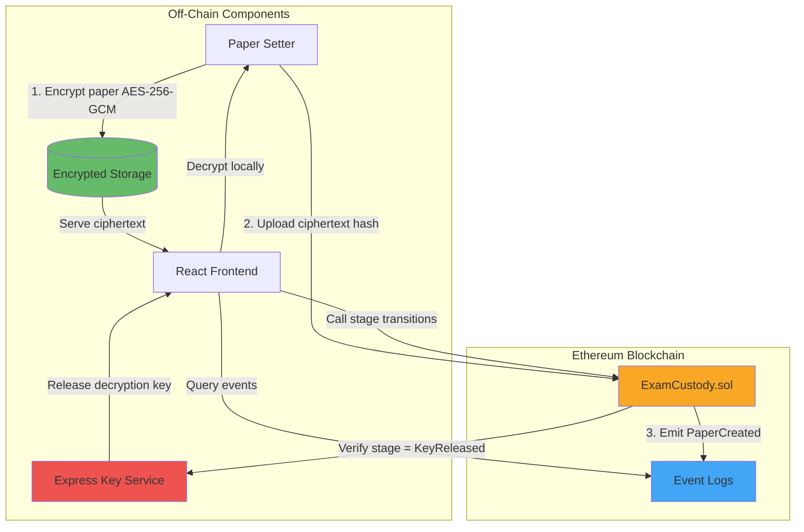
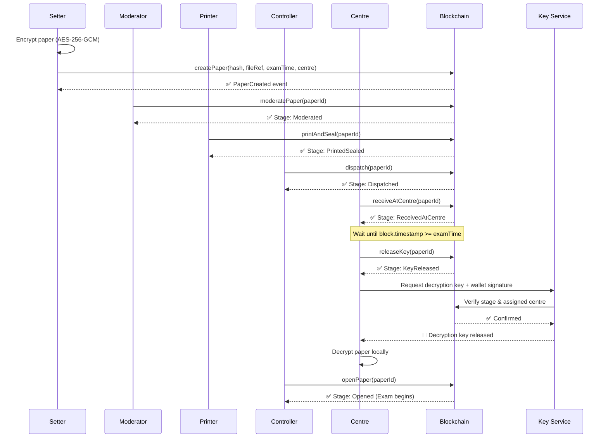

# ExamPaperCustody

> Blockchain-based chain-of-custody DApp for exam question paper integrity and leak prevention.

[](https://soliditylang.org/)
[](https://hardhat.org/)

---

## 🎯 Problem Statement

Exam paper leaks are a persistent threat to academic integrity. Traditional custody systems rely on:
- **Manual paper trails** that can be altered or lost
- **Trust-based hand-offs** with no cryptographic verification
- **Centralized control** vulnerable to single points of failure
- **No real-time auditability** for stakeholders

When a leak occurs, it's often impossible to pinpoint *where* and *when* the compromise happened.

**ExamPaperCustody** solves this by creating an **immutable, transparent, and decentralized** audit trail on the Ethereum blockchain.

---

## 💡 Solution Overview

Every question paper follows a strict **chain-of-custody pipeline** enforced by a smart contract:

```
Created → Moderated → PrintedSealed → Dispatched → ReceivedAtCentre → KeyReleased → Opened
```

**Key Security Features:**
- **Off-chain encryption**: Papers are AES-256-GCM encrypted; only ciphertext hashes live on-chain.
- **Role-based access**: OpenZeppelin AccessControl ensures only authorized actors can trigger transitions.
- **Time-locked decryption**: Keys are released only when `block.timestamp >= examTime`.
- **Immutable audit trail**: Every custody hand-off emits an on-chain event that cannot be tampered with.
- **Emergency freeze**: Any stakeholder can flag a paper as `Compromised`, halting all operations.

---

## 🏗️ Architecture



### Data Flow



---

## 👥 Roles & Permissions

| Role | Responsibilities | Can Trigger |
|------|-----------------|-------------|
| **Controller** (Admin) | Deploys contract, grants/revokes roles, authorizes dispatch & opening | `dispatch()`, `openPaper()`, role management |
| **Setter** | Encrypts papers off-chain, uploads ciphertext hash & metadata | `createPaper()` |
| **Moderator** | Reviews and approves exam papers | `moderatePaper()` |
| **Printer** | Prints and physically seals paper packets | `printAndSeal()` |
| **Centre** | Receives packets, releases decryption key at exam time | `receiveAtCentre()`, `releaseKey()` |
| **Any Role** | Emergency leak response | `flagCompromised()` |

---

## 🔐 Security Model

### Threat Model

| Threat | Mitigation |
|--------|-----------|
| **Paper leak during creation** | Off-chain AES-256-GCM encryption; plaintext never touches blockchain |
| **Unauthorized stage skip** | Smart contract enforces strict stage ordering via `onlyStage` modifier |
| **Wrong role advancing stage** | OpenZeppelin AccessControl + role-specific function modifiers |
| **Premature key release** | `releaseKey()` enforces `block.timestamp >= examTime` check |
| **Centre A unlocking Centre B's paper** | `releaseKey()` validates `msg.sender == papers[id].centre` |
| **Compromised key service** | Backend verifies on-chain stage before releasing keys; ECDSA signature required |
| **Replay attacks on key service** | Challenge-response protocol with timestamp validation |
| **Post-compromise forensics** | Immutable event logs pinpoint exact stage & actor where compromise occurred |

### What We Don't Protect Against

- **Smart contract vulnerabilities**: Formal verification not performed (use audited code in production).
- **Private key theft**: If a role's private key is stolen, the attacker can act as that role.
- **51% attacks**: Assumes Ethereum consensus remains secure.
- **Side-channel attacks**: Physical security of printed papers is outside scope.
- **Coercion**: Cannot prevent actors from being forced to perform legitimate transitions.

---

## 🛠️ Tech Stack

| Layer | Technology |
|-------|-----------|
| **Smart Contract** | Solidity ^0.8.20, OpenZeppelin AccessControl |
| **Blockchain Tooling** | Hardhat 2.29, ethers.js v6 |
| **Backend** | Node.js, Express 5.3, AES-256-GCM (native crypto) |
| **Frontend** | React 18, Vite 6, Web3 provider |
| **Network** | Ethereum (Sepolia testnet / local Hardhat) |

---

## 📂 Project Structure

```
ExamPaperCustody/
├── contracts/
│   └── ExamCustody.sol          # Main smart contract
├── test/
│   ├── ExamCustody.test.js      # 45 contract unit tests
│   └── KeyService.test.js       # 13 backend integration tests
├── scripts/
│   ├── deploy.js                # Local deployment script
│   └── deploySepolia.js         # Testnet deployment script
├── server/
│   ├── server.js                # Express key service API
│   ├── cryptoUtils.js           # AES-256-GCM encryption utilities
│   ├── encryptPaper.js          # CLI tool for paper encryption
│   └── storage/                 # Encrypted ciphertexts & keys (gitignored)
├── client/
│   ├── src/
│   │   ├── components/          # React UI components
│   │   └── utils/               # Web3 & crypto helpers
│   └── dist/                    # Production build output
├── docs/
│   ├── DEV_LOG.md               # Development journal
│   └── EXPLAINED.md             # Technical deep-dive & FAQs
├── hardhat.config.js
├── package.json
├── .env.example                 # Template for environment secrets
└── README.md                    # This file
```

---

## 🚀 Setup & Installation (Windows 11)

### Prerequisites

- **Node.js**: v18+ ([Download](https://nodejs.org/))
- **Git**: ([Download](https://git-scm.com/download/win))
- **MetaMask**: Browser extension ([Install](https://metamask.io/))
- **Sepolia ETH**: For testnet deployment ([Faucet](https://sepoliafaucet.com/))

### 1. Clone & Install

```powershell
git clone https://github.com/Amogh050/ExamPaperCustody.git
cd ExamPaperCustody
npm install
cd client
npm install
cd ..
```

### 2. Compile Contracts

```powershell
npm run compile
```

Expected output: `Compiled 1 Solidity file successfully`

### 3. Run Tests

```powershell
npm run test
```

Expected: **58 passing tests** (45 contract + 13 server)

---

## 🎬 Demo Script (Local Development)

### Terminal 1: Start Hardhat Node

```powershell
npm run node
```

Hardhat will spin up a local Ethereum node at `http://127.0.0.1:8545` with 20 pre-funded accounts.

### Terminal 2: Deploy Contract

```powershell
npm run deploy
```

This will:
- Deploy `ExamCustody.sol` to the local network
- Assign roles to Hardhat test accounts (accounts #0-5)
- Export `deployment.json` with contract address & ABI

**Sample Output:**
```
ExamCustody deployed to: 0x5FbDB2315678afecb367f032d93F642f64180aa3
[OK] Granted Setter role to 0x70997970C51812dc3A010C7d01b50e0d17dc79C8
[OK] Granted Moderator role to 0x3C44CdDdB6a900fa2b585dd299e03d12FA4293BC
...
```

### Terminal 3: Start Key Service Backend

```powershell
npm run server
```

Backend runs at `http://localhost:3001`

### Terminal 4: Start React Frontend

```powershell
npm run client
```

Frontend runs at `http://localhost:5173`

---

## 📝 Usage Walkthrough

### Step 1: Encrypt a Paper (Off-Chain)

As the **Setter**, create an exam paper:

```powershell
# Create a sample exam paper
echo "Q1. Explain blockchain consensus mechanisms." > exam-paper.txt

# Encrypt it
npm run encrypt
```

**Interactive Prompts:**
```
Enter paper ID: 1
Enter path to plaintext file: exam-paper.txt
Enter exam time (YYYY-MM-DD HH:MM): 2026-12-15 09:00
```

**Output:**
```
Ciphertext hash: 0xabc123...
Store this hash on-chain using createPaper()
```

### Step 2: Register Paper On-Chain

Open frontend → Switch to **Setter** role → Click **"Create Paper"**:
- Paste ciphertext hash
- Enter file reference (e.g., `ipfs://QmXyz...` or `papers/exam-1.enc`)
- Select exam date/time
- Select assigned exam centre wallet

### Step 3: Progress Through Pipeline

Switch roles in the frontend:

1. **Moderator**: Click "Approve Paper #1" → Stage becomes `Moderated`
2. **Printer**: Click "Mark Printed & Sealed #1" → Stage becomes `PrintedSealed`
3. **Controller**: Click "Dispatch Paper #1" → Stage becomes `Dispatched`
4. **Centre**: Click "Confirm Receipt #1" → Stage becomes `ReceivedAtCentre`

### Step 4: Time-Locked Key Release

- Wait until exam start time (or use Hardhat's `evm_increaseTime` for testing)
- **Centre** clicks "Release Key for Paper #1"
- Backend verifies:
  1. On-chain stage is `KeyReleased`
  2. Caller is the assigned centre (ECDSA signature)
  3. Paper is not compromised
- If all checks pass, backend returns AES decryption key

### Step 5: Decrypt & Open

- **Centre** decrypts paper locally in browser
- **Controller** marks paper as `Opened` (exam begins)

---

## 🌐 Sepolia Testnet Deployment

### 1. Configure Environment

```powershell
cp .env.example .env
```

Edit `.env`:
```env
SEPOLIA_RPC_URL=https://sepolia.infura.io/v3/YOUR_INFURA_PROJECT_ID
SEPOLIA_PRIVATE_KEY=0xYOUR_PRIVATE_KEY_HERE
ETHERSCAN_API_KEY=YOUR_ETHERSCAN_API_KEY
```

⚠️ **Security**: Use a dedicated testnet wallet. Never use your mainnet private key!

### 2. Get Sepolia ETH

Visit [https://sepoliafaucet.com/](https://sepoliafaucet.com/) and request testnet ETH for your deployer address.

### 3. Deploy to Sepolia

```powershell
npm run deploy:sepolia
```

The script will:
- Deploy the contract to Sepolia
- Prompt you to enter wallet addresses for each role
- Grant roles on-chain
- Save deployment info to `deployment-sepolia.json`

### 4. Verify Contract (Optional)

```powershell
npm run verify:sepolia <CONTRACT_ADDRESS>
```

This publishes the source code to [Sepolia Etherscan](https://sepolia.etherscan.io/).

---

## 🧪 Testing

### Run All Tests

```powershell
npm run test
```

### Coverage Breakdown

- **ExamCustody.test.js** (45 tests):
  - Deployment & role initialization
  - Happy path: full pipeline progression
  - Access control: wrong role reverts
  - Stage validation: skip/regress detection
  - Time-lock enforcement
  - Assigned centre verification
  - Compromise freeze semantics
  - End-to-end integration test

- **KeyService.test.js** (13 tests):
  - ECDSA signature verification
  - Challenge-response protocol
  - Stage gating for key release
  - Assigned centre enforcement
  - Decryption endpoint validation

---

## 🐛 Known Limitations

1. **No IPFS integration**: File references are strings; you must implement IPFS pinning separately.
2. **Single key service**: Centralized Express server is a trust bottleneck. Production should use threshold cryptography (e.g., Shamir's Secret Sharing).
3. **No gas optimization**: Contract uses ~200-run optimizer; production may need further tuning.
4. **No contract upgradability**: Uses non-upgradeable contracts; state migration requires redeployment.
5. **Basic frontend**: UI is functional but not production-grade (no responsive design, accessibility features minimal).
6. **Windows-specific**: Setup instructions assume Windows 11 + PowerShell; adapt for Linux/macOS.

---

## 🔍 Future Enhancements

- [ ] Multi-signature key release (require M-of-N centres to agree)
- [ ] IPFS integration with Pinata/Web3.Storage
- [ ] Mobile app (React Native + WalletConnect)
- [ ] Zero-knowledge proofs for paper verification without revealing content
- [ ] Cross-chain bridge for multi-university federations
- [ ] Gas cost dashboard & optimization

---

## 🤝 Contributing

This project is open for contributions! Areas needing help:

- **Security audits**: Review smart contract logic for vulnerabilities
- **Gas optimization**: Reduce deployment & transaction costs
- **Frontend polish**: Improve UX/UI, add accessibility features
- **Documentation**: Expand integration guides for other institutions

**How to contribute:**
1. Fork the repo
2. Create a feature branch: `git checkout -b feature/amazing-feature`
3. Commit changes: `git commit -m 'feat: add amazing feature'`
4. Push to branch: `git push origin feature/amazing-feature`
5. Open a Pull Request

---

### Development Tools

- **OpenZeppelin Contracts**: Battle-tested AccessControl implementation
- **Hardhat**: Modern Ethereum development environment
- **ethers.js**: Ethereum library for smart contract interaction


## 📧 Contact

**Project Maintainer**: Amogh  
**Repository**: [https://github.com/Amogh050/ExamPaperCustody](https://github.com/Amogh050/ExamPaperCustody)

For questions, issues, or collaboration inquiries, please open a GitHub issue.

---

## 🔖 Quick Links

- [Hardhat Documentation](https://hardhat.org/docs)
- [OpenZeppelin AccessControl](https://docs.openzeppelin.com/contracts/4.x/access-control)
- [Solidity Documentation](https://docs.soliditylang.org/)
- [ethers.js v6 Guide](https://docs.ethers.org/v6/)
- [Sepolia Testnet Faucet](https://sepoliafaucet.com/)
- [Technical Deep-Dive (EXPLAINED.md)](docs/EXPLAINED.md)

---

**Built with 🔐 for academic integrity.**
